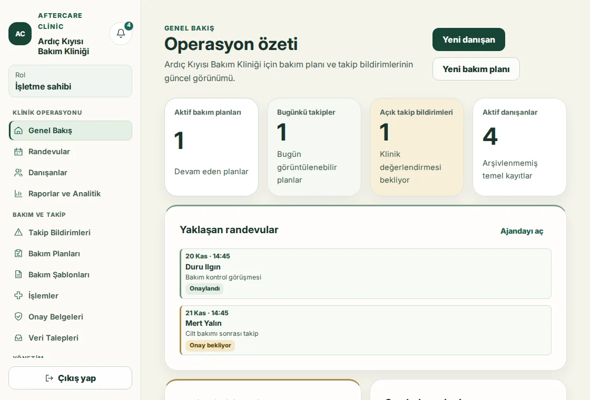
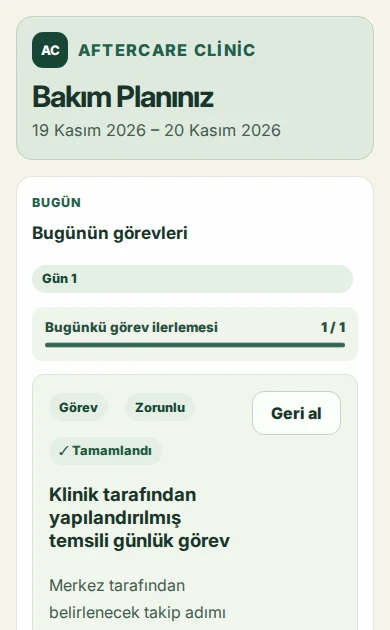
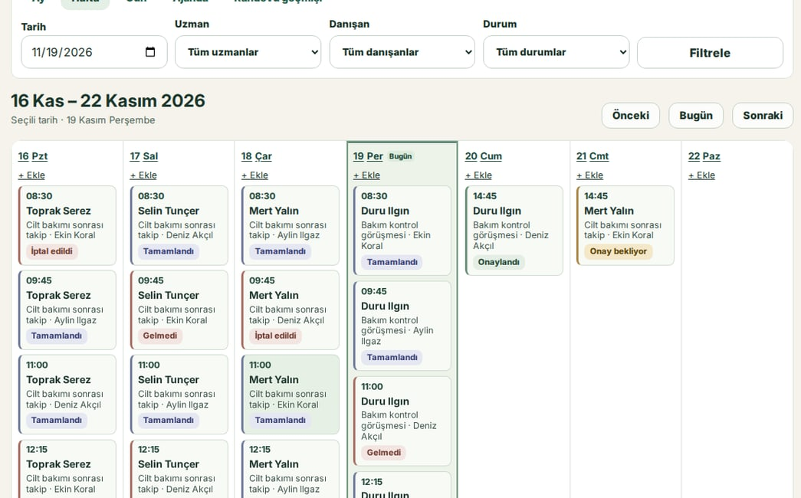
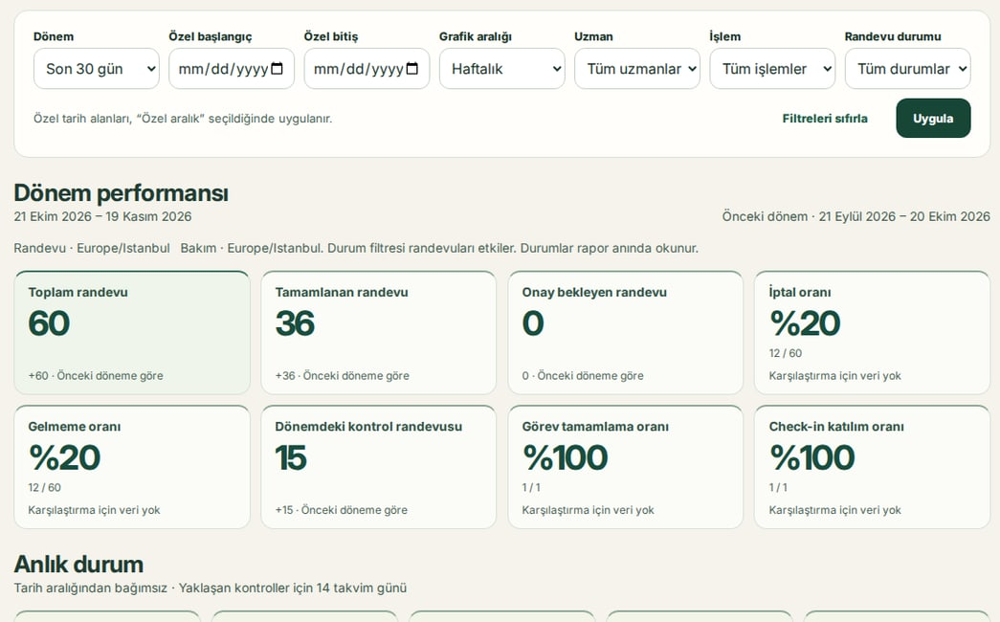
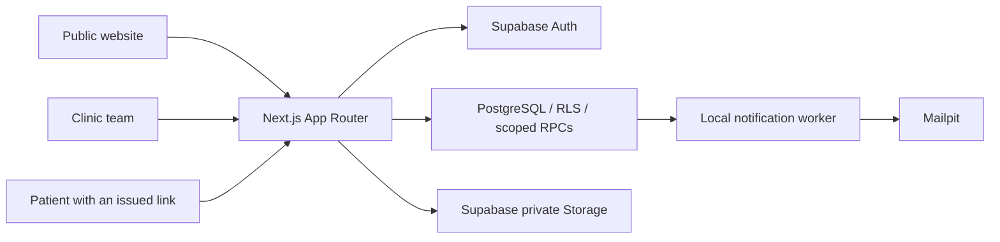

# AfterCare Clinic

**V1.0 Portfolio Edition** · Clinic operations and post-procedure follow-up

AfterCare Clinic connects a clinic workspace with a mobile patient portal. The portfolio release candidate runs on fictional clinics, patients, and operations. It models administrative follow-up and records clinic decisions, with clinical judgment left to the care team. See the [v1.0 release notes](RELEASE_NOTES.md).

## Problem

An appointment, a follow-up plan, a patient’s daily tasks, and the clinic’s review queue often live in separate tools. AfterCare groups these steps around one care plan so staff can see what is due, patients can follow the plan shared by their clinic, and each organization can keep its records isolated.

## Product tour

| Area | Working flows |
| --- | --- |
| Public website | Product pages, FAQ, privacy and terms drafts, clinic sign-in, local-only demo and contact forms |
| Clinic workspace | Clients, procedures, published template versions, care plan snapshots, alerts, consents, data requests, clinic settings and team |
| Patient portal | Revocable secure link, scoped session, daily tasks, check-ins, requested photo uploads, consent decisions and data requests |
| Appointments | Calendar, mobile agenda, specialist availability, appointment states and gated local online booking |
| Notifications | In-app inbox, read state, preferences and local Mailpit notification delivery |
| Analytics | Date and status filters, specialist scoping, period comparisons and aggregate CSV |

| Clinic dashboard | Mobile patient portal |
| --- | --- |
|  |  |

| Appointment calendar | Analytics |
| --- | --- |
|  |  |

The screens above use the bundled [Inter and Gelasio typefaces](docs/references/bundled-typefaces.md), including their Turkish glyphs.

## Roles

- **Owner** manages the clinic, team and operational work. **Admin** handles clinic operations and authorized administration under the organization’s permissions.
- **Staff** operates within assigned scopes. Tenant membership and resource policies protect data independently of the navigation.
- **Patient** opens a clinic-issued link that exchanges for a bounded portal session. The session is scoped to the assigned plan.
- **Public visitor** can explore the product pages. Hosted inquiry forms and public signup are disabled for the portfolio plan.

## Architecture



- **Application** uses Next.js App Router, React, TypeScript, Zod and a shared responsive CSS design system. Sharp normalizes uploaded images. Application services and route handlers own authentication, request validation and sensitive responses.
- **Data boundary** uses Supabase Auth and PostgreSQL memberships, permissions, tenant-scoped foreign keys and row-level security. Care plans snapshot published template versions. Append-only events preserve task, consent and review history.
- **Portal and photos** use hash-only link tokens, short-lived HttpOnly sessions, revocation and request limits. Private uploads pass through validation and metadata stripping. Photo access uses short-lived signed URLs.
- **Secrets** stay server-side. The Supabase public key has limited scope. Session cookies, operational data and signed photo URLs are excluded from public pages and shared caches.

## Local installation

Use Node.js 24, npm, Git and a running Docker engine. Use a fresh clone and a dedicated local Supabase stack. Check that the project ID and ports in `supabase/config.toml` do not identify an existing database before starting or running reset-based checks.

```bash
npm ci
npm run supabase:start
npm run supabase:write-env
npm run dev
```

Open `http://localhost:3000`. The local seed creates synthetic clinic accounts. Use the credentials described in the [local demo runbook](docs/playbooks/demo-runbook.md). `supabase:write-env` writes the local connection settings to the Git-ignored `.env.local` file. Keep those settings on your machine.

The standard seed supplies stable regression fixtures. The fictional screen-gallery dataset is an optional overlay documented in the [showcase setup](docs/playbooks/portfolio-showcase.md).

## Environment configuration

See [`.env.example`](.env.example) for names and placeholders. `NEXT_PUBLIC_SUPABASE_URL`, `NEXT_PUBLIC_SUPABASE_ANON_KEY` and the optional `AFTERCARE_PUBLIC_SITE_URL` are public. `APP_ENV` and the project references select the environment. The service-role key, audit and rate-limit peppers, and cleanup tokens are server-only. Use dedicated server secrets and environment-scoped settings for any hosted preview.

## Testing

```bash
npm run lint
npm run typecheck
npm test
npm run build
npm run verify:migration-integrity
npm run test:db
npm run test:rls:local
npm audit --audit-level=high
npm audit --omit=dev --audit-level=high
```

`verify:phase9b` and `verify:predeploy` exercise end-to-end behavior, migrations, SQL contracts, tenant isolation, photo boundaries and demo readiness. Both reset the active local test database. Run them only in a disposable stack. `verify:predeploy` includes its own clean `npm ci` installation. Playwright covers clinical, patient and public flows with seeded users and local Mailpit. The portfolio golden journey covers care plan creation through link revocation. Use the [cross-browser config](playwright.cross-browser.config.ts) for Firefox and WebKit on the same isolated stack.

```bash
npx playwright install chromium firefox webkit
npm run verify:phase9b
npm run verify:predeploy
npx playwright test --config playwright.cross-browser.config.ts tests/e2e/portfolio-golden-journey.spec.ts --project=firefox
```

## Public presentation

The first public portfolio release is a standalone, read-only screenshot gallery. It uses the same fictional clinic imagery as the product tour and runs without an application server, database or credentials. The gallery is published separately from the operational application. A hosted interactive demo remains a separate future stage.

## Portfolio Edition limitations

The dataset is fictional. Public claims, analytics and screenshots describe the software and synthetic operations. The demo has no public patient-data intake, real email/SMS/WhatsApp delivery, billing, or production operations. The privacy and terms pages are drafts. Hosted interactivity requires an independently isolated project and explicit publication approval. Physical iOS validation and a formal healthcare or legal review are outside the local release candidate.

## Roadmap

The original [master roadmap](docs/product/master-roadmap.md) is preserved. The portfolio includes Phase 10 public experience, Phase 11 local clinic administration, Phase 12 appointments, Phase 13 local notifications and Phase 15 analytics. Phase 14 billing, Phase 16 platform operations and Phase 17 production go-live remain reserved for a later decision.
